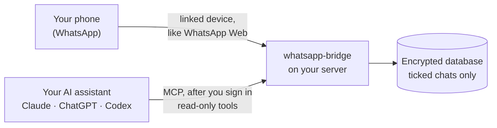

<div align="center">

# whatsapp-bridge

**Ask your AI assistant about your WhatsApp chats. Self-hosted and read-only.**

[](https://github.com/vid-t/whatsapp-bridge/actions/workflows/ci.yml)
[](LICENSE)

</div>

whatsapp-bridge links to your WhatsApp as an extra device, the way WhatsApp Web does. It keeps
the chats you choose in an encrypted database on your own server. Claude, ChatGPT, Codex or
any other MCP client can then search and read those chats when you ask. It never sends a
message.

> *"What delivery date did we agree with the supplier last week?"*
>
> *"Find the lease PDF Maria sent and tell me what she said about it."*

## How it works



1. **Link.** On your phone, open **Settings › Linked devices › Link a device** and scan the
   QR code. The bridge now receives your messages like any other linked device.
2. **Tick.** Choose which chats it keeps. New chats start ticked: untick the ones you want
   left out, and the bridge deletes what it stored for them.
3. **Ask.** Connect your assistant to `https://<your server>/mcp` and sign in. It searches
   and reads your ticked chats when it needs to, and cites every message it uses.

## Try it locally

You need Go 1.27 or newer. The web UI is built into the binary.

```sh
git clone https://github.com/vid-t/whatsapp-bridge.git && cd whatsapp-bridge
CGO_ENABLED=0 go build -o bin/whatsapp-bridge ./cmd/whatsapp-bridge
./bin/whatsapp-bridge keygen > whatsapp-bridge.env && chmod 600 whatsapp-bridge.env
./bin/whatsapp-bridge serve -env-file whatsapp-bridge.env
```

Open <http://127.0.0.1:8080>, enter the access code from `whatsapp-bridge.env`, link
WhatsApp and tick your chats.

> [!IMPORTANT]
> `whatsapp-bridge.env` holds the database key. Without it the database cannot be read, so
> back it up.

## Run it on a server

claude.ai and ChatGPT reach the bridge from their own servers, so they need a public HTTPS
address. Claude Code and Codex also work over `localhost` or a private network.
[`deploy/SELF-HOSTING.md`](deploy/SELF-HOSTING.md) has three paths. Each ends at
`https://<your domain>` with automatic HTTPS from Caddy.

| Path | Best for |
|---|---|
| [**A. cloud-init**](deploy/SELF-HOSTING.md#path-a-one-click-vps-with-cloud-init) | a fresh VPS: paste one file and boot |
| [**B. Docker Compose**](deploy/SELF-HOSTING.md#path-b-docker-compose) | a server that already runs Docker |
| [**C. Install script**](deploy/SELF-HOSTING.md#path-c-a-server-you-already-have) | an existing Ubuntu 24.04 or Debian 12 server |

You need a domain pointing at the server, with ports 80 and 443 open.

## Connect your assistant

In Claude Code:

```sh
claude mcp add --transport http whatsapp-bridge https://<host>/mcp
claude mcp login whatsapp-bridge
```

In claude.ai, Claude Desktop, ChatGPT or Codex, add `https://<host>/mcp` as a connector and
sign in on the page that opens. [`docs/MCP-SETUP.md`](docs/MCP-SETUP.md) has the steps for
each assistant, plus API keys for scripts.

Your assistant gets six read-only tools:

| Tool | What it does |
|---|---|
| `search_messages` | full-text search across the ticked chats |
| `read_chat` | read one chat in time order |
| `get_message_context` | show the messages around a search hit |
| `list_chats` | list the ticked chats, most recent first |
| `get_document` | give the file name and caption of an attachment |
| `get_status` | show the linked devices and how fresh the data is |

Every message comes with a `wa://` citation, so you can check the source of an answer.

## Privacy and safety

- **Read-only.** The code has no way to send messages, an "online" status or read receipts.
  The tools cannot change or delete anything.
- **Only ticked chats.** Unticked chats are never stored, so no assistant can see them.
- **Encrypted at rest.** The database file is encrypted with Adiantum when `BRIDGE_DB_KEY`
  is set (`keygen` creates it). A running bridge decrypts messages in memory, so run it on
  a machine you control.
- **Closed by default.** It listens on `127.0.0.1` and refuses a public address unless an
  access code and a database key are set.
- **Audited.** Every tool call is logged: who called it, which tool, which chats and how
  many rows. The log never holds message text.
- **Nothing goes to an AI provider on its own.** Your assistant gets messages only when it
  calls a tool, and only that call's results.
- **Your phone stays in charge.** Unlink the device in WhatsApp and the bridge is cut off
  at once. WhatsApp also logs out linked devices when the phone has been offline for 14
  days.

> [!WARNING]
> **Unofficial client.** whatsapp-bridge uses [whatsmeow](https://github.com/tulir/whatsmeow),
> an unofficial implementation of the WhatsApp Web protocol. It is not affiliated with,
> endorsed by or connected to WhatsApp or Meta. WhatsApp does not permit unofficial
> clients, and an account linked to one can be restricted. Staying silent and read-only
> keeps that risk low but cannot remove it. You accept it when you link an account.

**Not built yet:** downloading attachments and reading their text, and limiting what each
member sees (today every member sees all ticked chats).

## Documentation

- [Configuration and commands](docs/CONFIGURATION.md): every setting, flag and command
- [Self-hosting](deploy/SELF-HOSTING.md): install, upgrade and back up
- [Connect your assistant](docs/MCP-SETUP.md): Claude, ChatGPT, Codex and API keys
- [Security policy](SECURITY.md) · [Contributing](CONTRIBUTING.md)

## Licence

[AGPL-3.0-only](LICENSE). If you run a modified whatsapp-bridge as a service, you must offer
its source code to the people who use it.
