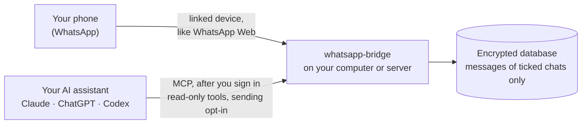

<div align="center">

# whatsapp-bridge

**A self-hosted bridge and setup gateway, built on whatsmeow, for storing and accessing your raw WhatsApp data**

[](https://github.com/vid-t/whatsapp-bridge/actions/workflows/ci.yml)
[](LICENSE)

</div>

whatsapp-bridge links to your WhatsApp as an extra device, the way WhatsApp Web does. It keeps
the chats you choose in an encrypted database on your own computer or server, where you can
search them or query them over MCP. It is read-only unless you turn on sending.

## How it works



1. **Link.** On your phone, open **Settings › Linked devices › Link a device** and scan the
   QR code. The bridge now receives your messages like any other linked device in WhatsApp.
2. **Tick.** Choose only which chats it keeps. Every chat starts unticked, and the bridge
   stores none of its messages until you tick it. Tick within an hour of linking to also
   keep the history WhatsApp sends at linking.
3. **Ask.** Connect your assistant to the bridge's `/mcp` address and sign in. It searches
   and reads your ticked chats when it needs to, and cites every message it uses.

## Where to run it

| You use | Run it | Why |
|---|---|---|
| Claude Code or Codex | [on your computer](#run-it-on-your-computer) | they connect from your machine, so `localhost` works |
| claude.ai, Claude Desktop, ChatGPT, or a team | [on a server](#run-it-on-a-server) | they connect from their own servers, so they need a public HTTPS address |

## Run it on your computer

macOS or Linux, on amd64 or arm64. No Go needed: these lines download the latest release
into `~/whatsapp-bridge`, create your keys once, and start the bridge.

```sh
mkdir -p ~/whatsapp-bridge && cd ~/whatsapp-bridge
os=$(uname -s | tr A-Z a-z); arch=$(uname -m | sed 's/x86_64/amd64/;s/aarch64/arm64/')
curl -fsSL "https://github.com/vid-t/whatsapp-bridge/releases/latest/download/whatsapp-bridge_${os}_${arch}.tar.gz" | tar -xzf - whatsapp-bridge
[ -e whatsapp-bridge.env ] || (umask 077; ./whatsapp-bridge keygen > whatsapp-bridge.env)
./whatsapp-bridge serve -env-file whatsapp-bridge.env
```

Open <http://127.0.0.1:8080> and enter the access code from `whatsapp-bridge.env`. Link
WhatsApp, then tick your chats within the hour to keep their recent history.

In a second terminal, connect Claude Code:

```sh
claude mcp add --transport http --scope user whatsapp-bridge http://127.0.0.1:8080/mcp
claude mcp login whatsapp-bridge
```

For Codex, run `codex mcp add whatsapp-bridge --url http://127.0.0.1:8080/mcp`.

Leave the bridge running to keep your chats up to date. Its data is in
`~/whatsapp-bridge/data`. To upgrade, stop it and run the same lines again: they replace the
binary and keep your keys and data.

> [!IMPORTANT]
> `whatsapp-bridge.env` holds the database key. Without it the database cannot be read, so
> back it up.

To build from source instead, clone the repository, build as in
[CONTRIBUTING.md](CONTRIBUTING.md#build-and-test), and use `bin/whatsapp-bridge` in the lines
above.

## Run it on a server

claude.ai, Claude Desktop and ChatGPT reach the bridge from their own servers, so it needs a
public HTTPS address. [`deploy/SELF-HOSTING.md`](deploy/SELF-HOSTING.md) has three paths.
Each ends at `https://<your domain>` with automatic HTTPS from Caddy.

| Path | Best for |
|---|---|
| [**A. cloud-init**](deploy/SELF-HOSTING.md#path-a-one-click-vps-with-cloud-init) | a fresh VPS: paste one file and boot |
| [**B. Docker Compose**](deploy/SELF-HOSTING.md#path-b-docker-compose) | a server that already runs Docker |
| [**C. Install script**](deploy/SELF-HOSTING.md#path-c-a-server-you-already-have) | an existing Ubuntu 24.04 or Debian 12 server |

You need a domain pointing at the server, with ports 80 and 443 open.

## Connect your assistant

The bridge's MCP address is `http://127.0.0.1:8080/mcp` on your computer and
`https://<your domain>/mcp` on a server. In Claude Code, add it with `claude mcp add` and
sign in with `claude mcp login`, as above. In claude.ai, Claude Desktop, ChatGPT or Codex,
add it as a connector and sign in on the page that opens.
[`docs/MCP-SETUP.md`](docs/MCP-SETUP.md) has the steps for each assistant, plus API keys for
scripts.

Your assistant gets six read-only tools:

| Tool | What it does |
|---|---|
| `search_messages` | full-text search across the ticked chats |
| `read_chat` | read one chat in time order |
| `get_message_context` | show the messages around a search hit |
| `list_chats` | list the ticked chats, most recent first |
| `get_document` | give the file name and caption of an attachment |
| `get_status` | show the linked devices and how fresh the data is |

Every message comes with a `wa://` citation, so you can check the source of an answer.

**Sending is off unless you turn it on.** Set `BRIDGE_ALLOW_SEND=1` and your assistant also
gets `send_message`, which sends a text message to one ticked chat from your account. It
cannot send to an unticked chat, and once you untick a chat nothing more can be sent to it.
Each assistant must also be allowed to send when you approve it. Assistants you approved
before stay read-only until you connect them again.
[`docs/CONFIGURATION.md`](docs/CONFIGURATION.md#sending-messages) has the details and limits.

## Privacy and safety

- **Read-only unless you turn on sending.** By default the bridge sends nothing. With
  `BRIDGE_ALLOW_SEND=1`, assistants you allowed to send can send text messages, to ticked
  chats only. It never
  sends an "online" status or read receipts, and the tools cannot change or delete anything.
- **Only ticked chats.** Chats start unticked. The bridge never stores the messages of an
  unticked chat, only its name and last activity for the chat list, so no assistant can see
  it. For an hour after you link a phone, it holds those messages in memory only, so a chat
  you tick in that hour keeps its history. Then they are dropped.
- **Encrypted at rest.** The database file is encrypted with Adiantum when `BRIDGE_DB_KEY`
  is set (`keygen` creates it). A running bridge decrypts messages in memory, so run it on
  a machine you control.
- **Closed by default.** It listens on `127.0.0.1` and refuses a public address unless an
  access code and a database key are set.
- **Audited.** Every tool call is logged: who called it, which tool, which chats and how
  many rows. The log never holds message text.
- **Nothing goes to an AI provider on its own.** Your assistant gets messages only when it
  calls a tool, and only that call's results.
- **Your phone stays in charge.** Unlink the device in WhatsApp and the bridge is cut off
  at once. WhatsApp also logs out linked devices when the phone has been offline for 14
  days.

> [!WARNING]
> **Unofficial client.** whatsapp-bridge uses [whatsmeow](https://github.com/tulir/whatsmeow),
> an unofficial implementation of the WhatsApp Web protocol. It is not affiliated with,
> endorsed by or connected to WhatsApp or Meta. WhatsApp does not permit unofficial
> clients, and an account linked to one can be restricted. Staying silent and read-only
> keeps that risk low but cannot remove it, and turning on sending raises it: send what a
> person would send, never bulk messages. You accept the risk when you link an account.

**Not built yet:** downloading attachments and reading their text, and limiting what each
member sees (today every member sees all ticked chats).

## Documentation

- [Configuration and commands](docs/CONFIGURATION.md): every setting, flag and command
- [Self-hosting](deploy/SELF-HOSTING.md): install, upgrade and back up
- [Connect your assistant](docs/MCP-SETUP.md): Claude, ChatGPT, Codex and API keys
- [Security policy](SECURITY.md) · [Contributing](CONTRIBUTING.md)

## Licence

[AGPL-3.0-only](LICENSE). If you run a modified whatsapp-bridge as a service, you must offer
its source code to the people who use it.
